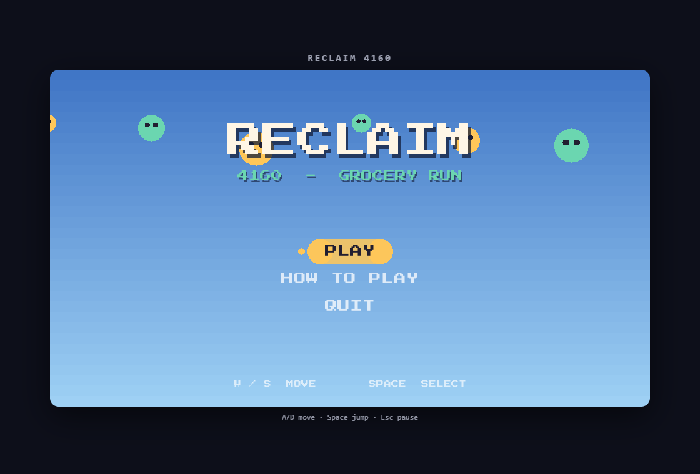
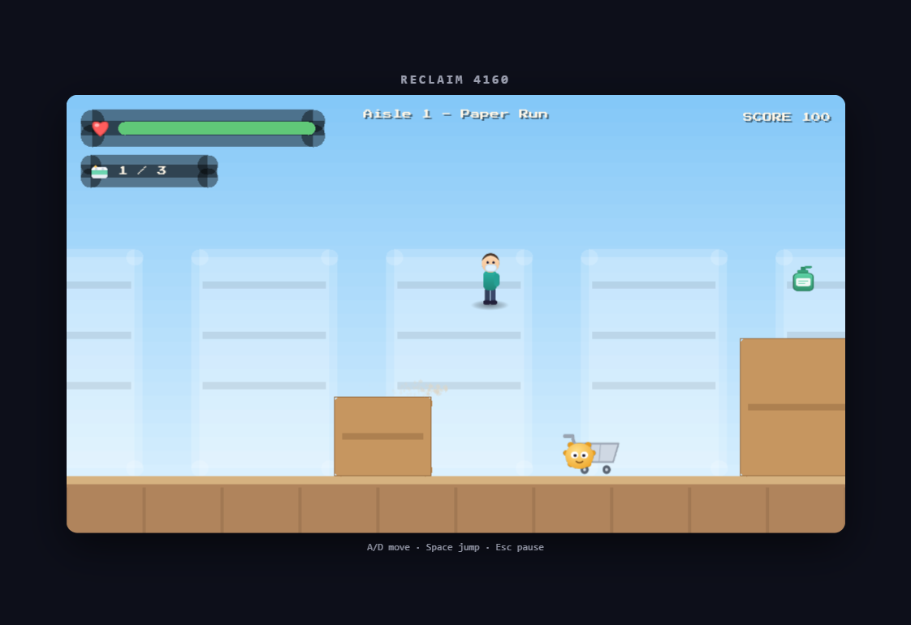

<p align="center">
  
</p>

<h1 align="center">Reclaim&nbsp;4160</h1>

<p align="center">
  A polished 2D side-scrolling "grocery run" written from scratch in modern C++ —<br>
  it builds to a <b>native desktop binary</b> and, from the same source, to <b>WebAssembly</b> for the browser.
</p>

---

## What it is

**Reclaim-4160** is a small action-platformer about surviving a pandemic-era supply
shortage. You play a masked shopper who must sweep a supermarket aisle, grab every last
roll of **toilet paper**, and reach the **checkout** before the roaming **germs** drain
your health.

It started life as a CPSC 4160 (*2D Game Engine Construction*) class project. This is a
ground-up rewrite: a clean, modern **C++20** engine with no game-engine dependency
(SDL2 only), organized into modules, with a generated **SVG art pipeline** and a fully
**procedural audio** system. The same single codebase compiles to a native executable and
to WebAssembly.

<p align="center">
  
</p>

## Features

- **Modern C++20 engine written from scratch** — game loop, scene manager, delta-timed
  update, AABB physics/collision, sprite rendering, cached text, particles, and screen shake.
- **Runs native and on the web** — one CMake project targets SDL2 on desktop and the
  Emscripten SDL2 ports (`SDL2`, `SDL2_image`, `SDL2_ttf`, `SDL2_mixer`) for the browser.
- **Best-practice C++** — RAII wrappers for every SDL handle, `std::unique_ptr` ownership,
  no raw owning pointers, `enum class`, `const`-correct APIs, namespaces, and **no global
  singletons** (a single `Game` object owns all services and hands them out explicitly).
- **Game feel** — coyote time + jump buffering, variable jump height, squash-and-stretch,
  invulnerability frames with knockback, particle bursts, and camera shake.
- **Two levels** with escalating difficulty, scored progression, and a best-score tracker.
- **Enemies** (patrollers and chasers) with a finite-state AI; stomp them from above for points.
- **Pickups** — toilet paper (objective) and hand sanitizer (heals you).
- **Pushable shopping carts**, jumpable crates, and a parallax store backdrop.
- **Full UI flow** — title, how-to-play, in-game HUD, pause, game over, and win screens.
- **Fully generated assets** — all art is authored as SVG and rasterized to PNG; all music
  and sound effects are synthesized to WAV by a Python script. No third-party assets.

## Controls

| Action | Keys |
| --- | --- |
| Move left / right | `A` / `D` (or `←` / `→`) |
| Jump | `Space` / `W` / `↑` — hold for a higher jump |
| Stomp an enemy | Jump and land on it from above |
| Pause | `Esc` |
| Navigate menus | `W` / `S` (or `↑` / `↓`) |
| Confirm menu option | `Space` / `Enter` |

**Objective:** collect every roll of toilet paper in the aisle, then walk into the glowing
checkout to clear the level. Sanitizer restores health; germs cost it.

---

## Project layout

```
.
├── CMakeLists.txt          Build for native + Emscripten (one project, two targets)
├── include/reclaim/        Public headers, one folder per module
│   ├── core/               Game, Renderer, Input, Assets, Audio, Font, Math, RAII handles
│   ├── gfx/                Sprite, ParticleSystem
│   ├── ui/                 TextRenderer, Menu, Hud
│   ├── world/              Entity, Player, Enemy, Pickup, Pushable, Checkout, Level
│   └── scenes/             Scene base + Title / Instructions / Play / Win / GameOver
├── src/                    Implementations (mirrors include/)
├── assets/
│   ├── images/             Generated PNG sprites (from SVG)
│   ├── fonts/              Display font (SIL OFL) + license
│   └── sounds/             Generated WAV sound effects + looping music
├── tools/
│   ├── gen-assets.mjs      SVG -> PNG rasterizer (@resvg/resvg-js)
│   └── gen-sounds.py       Procedural audio generator (Python stdlib)
├── web/shell.html          Emscripten HTML shell
├── scripts/                build-native / build-web helpers (.ps1 and .sh)
└── docs/                   Screenshots used by this README
```

## Prerequisites

- **CMake 3.20+** and a **C++20** compiler (GCC, Clang, or MSVC)
- **SDL2**, **SDL2_image**, **SDL2_ttf**, **SDL2_mixer** development libraries
- *(optional)* **Node 18+** to regenerate art, **Python 3** to regenerate audio
- *(optional)* the **Emscripten SDK** only for the WebAssembly build

## Build & run (native desktop)

```bash
cmake -S . -B build -DCMAKE_BUILD_TYPE=Release
cmake --build build
./build/reclaim            # Windows: build\reclaim.exe
```

Or use a helper script:

```bash
./scripts/build-native.sh      # macOS / Linux
```
```powershell
.\scripts\build-native.ps1      # Windows
```

The `assets/` folder is copied next to the executable automatically, so the relative
`assets/...` paths the game uses resolve with no extra setup.

## Build & run (WebAssembly)

Install and activate the Emscripten SDK once:

```bash
git clone https://github.com/emscripten-core/emsdk
cd emsdk
./emsdk install latest
./emsdk activate latest
source ./emsdk_env.sh        # Windows: .\emsdk_env.ps1
```

Then build the web target (the CMake project detects Emscripten and switches on the
`-sUSE_SDL=2` ports automatically):

```bash
./scripts/build-web.sh          # macOS / Linux
```
```powershell
.\scripts\build-web.ps1          # Windows
```

This produces:

```
build-web/reclaim.html   (uses web/shell.html)
build-web/reclaim.js
build-web/reclaim.wasm
build-web/reclaim.data   (the preloaded assets/ folder)
```

Browsers won't load WASM from `file://`, so serve the folder over HTTP:

```bash
cd build-web
python -m http.server 8000
# open http://localhost:8000/reclaim.html
```

Click the canvas to give it keyboard focus, then play.

## Regenerating assets

All art and audio are generated from source in `tools/` (both are optional — the output is
already committed under `assets/`):

```bash
npm install                 # installs @resvg/resvg-js
npm run assets              # SVG definitions -> assets/images/*.png
python tools/gen-sounds.py  # synth SFX + music -> assets/sounds/*.wav
```

## Architecture notes

- **`Game`** owns the window, renderer, asset manager, audio, text renderer, and the active
  `Scene`. Scenes request transitions through `Game::requestScene`. There are **no globals**
  and **no singletons** — everything is passed explicitly.
- **Entities** never touch `Game`. `PlayScene` exposes a tiny interface (input, solid rects,
  player position, particles, audio), so gameplay code stays decoupled and testable.
- **`Renderer`** applies a single camera offset to every draw call, so world-space and
  screen-space (HUD) rendering share one API; rounded rects and circles are built from
  primitives to avoid an `SDL2_gfx` dependency.
- **`AssetManager`** lazily loads and caches textures/fonts/sounds/music, handing out stable
  `const Texture*` / `Font*` handles. Paths go through `paths::` so the same relative
  `assets/...` lookup works natively and inside Emscripten's virtual filesystem.

## Credits

- **Original CPSC 4160 project** — team: Nikita Tran, Cameron Larson, Jason Lyle,
  Quinn Hubbarth; engine/gameplay by Patrick Goodwin (Dr. Victor Zordan's section).
- **This rewrite** — modern C++20 engine, modular architecture, SVG art pipeline,
  and procedural audio.
- **Font** — "Press Start 2P" by CodeMan38, licensed under the SIL Open Font License
  (see `assets/fonts/OFL.txt`).


